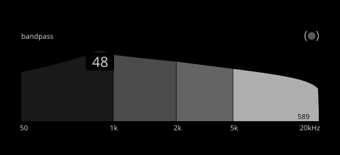

# Trine for OP-XY



Trine is a three-band, note-following instrument filter for the Teenage Engineering OP-XY. This repository contains the source, display assets, and build wrapper for Open-XY.

Select **trine** with Shift + M3 on an instrument track. The three ringing bands follow the played note. The upper two bands default to +4 and +7 semitones. Turn setup K3 down one semitone for a minor triad.

| Encoder | Turn on M3 | Turn in setup | Press in setup |
|---|---|---|---|
| K1 | Cutoff | Cycle the five exciters | |
| K2 | Resonance | Exciter blend | Return to M3 |
| K3 | Filter shape | Band 1 offset | Wide / Bypass |
| K4 | Decay | Band 2 offset | Resonator / Whole |

Press K2 on M3 to open setup. The four circle shades identify the knobs, darkest to lightest. Parentheses indicate a press.

The main graph follows the sweep before the exciter, ringing, and output gain. Its badge shows resonance on a 0–99 scale and follows the sweep frequency. The small value inside the lower-right corner shows decay in milliseconds, or Off.

Setup K1 cycles Crossing Pulse, Sub-Octave, Wave Folder, Modulo Wrap, and 1-bit Delta-Sigma in either direction. The selected logo lights up. K2 controls the blend in 1% steps. Its symbol brightens across 17 shades. Both band offsets range from −24 to +24 semitones. K4 on M3 gives Off and 150–1,300 ms of decay.

Wide sends all ringing through the sweep. Bypass sends 25% around it. Resonator applies the exciter at the bank input. Whole applies it before the direct and bank paths split.

New projects start with Crossing Pulse and zero blend. Older saved Clean and Octave Doubler settings keep their sound and show five dim logos until you turn setup K1. The setup belongs to the track and pattern. Keep the project’s .xy and .oxy files together.

## Build firmware

You need Git, Python 3.11 or newer, the Open-XY Blackfin toolchain, and an exact stock OP-XY OS 1.2.1 `os.ldr` copied from your own device. Follow the stock OS extraction steps in the [Open-XY build guide][build]. Keep the image outside the repository. Its SHA-256 is `60358afdaa9b58ed40411602f6d5d4e1e3e02553ff2da7e25038e71dd002b52f`.

### Build with TE Builder

In TE Builder, import this repository’s Git URL or the [Trine machine ZIP](release/Trine-sdk-1.17-rc4.zip). Select **Trine sdk-1.17-rc4**. This release uses Open-XY API 1.17 at commit `ca122f4`.

Run `python3 package_manager.py release/Trine-sdk-1.17-rc4.zip --check` to verify that the ZIP matches the checkout. Omit `--check` to rebuild the ZIP.

### Prepare the SDK

Run these commands from your Trine checkout on Apple silicon macOS. Use `py -3` in place of `python3` on Windows. On Linux x86-64, follow the [SDK toolchain build instructions][linux] to populate `local/toolchain` instead of using `toolchain fetch`.

```sh
git clone https://github.com/etcetc000/open-xy.git ../open-xy-sdk
git -C ../open-xy-sdk checkout --detach ca122f4062f08f13a3023904620a4c35ff9b4a45
python3 ../open-xy-sdk/sdk.py toolchain fetch
```

If you already have a prepared SDK, use its path in the build command. Trine applies its integration patches to a temporary checkout at the pinned revision. The prepared SDK stays intact. Pass `--tools` to use a toolchain bundle in a different location.

### Run the build

Adjust the stock image path to your own copy. Choose a new output directory for each build.

```sh
python3 build.py --sdk ../open-xy-sdk --stock-os "$HOME/Downloads/os.ldr" --out ../trine-build-01
```

On Windows PowerShell, use `"$env:USERPROFILE/Downloads/os.ldr"` for that path. The installable files go into `../trine-build-01/candidate/`.

### Install on the XY

Follow the [Open-XY installation guide][install] for MTP setup and host dependencies. On macOS, use **Dev Menu → MTP file transfer (mac)** and install `libusb` if needed. With the device in transfer mode, stage the complete candidate so the catalog and both displays go with the OS.

```sh
python3 ../open-xy-sdk/sdk.py device push ../trine-build-01/candidate
```

After the transfer reports **PASS**, exit MTP. With the OP-XY on power, choose **Write OS to boot partition** and wait for **firmware written ok!** before power-cycling. Open **Shift + M3** on an instrument track and select **trine**.

Trine RC4 and Septet 0.1.2 passed a hardware check together on an OP-XY. On Drumline and a second drum machine, the picker stayed responsive while previewing each filter, playing a note and switching away.

## Hardware check

Sweep cutoff and resonance together across the range. Check the badge at both ends and the decay readout at Off and 1,300 ms. Press K2. Turn K1 through all five logos and sweep K2 from dark gray to white. Adjust both intervals, press K3 and K4, then save and reload the project to confirm the selected settings.


## Upstream attribution

Trine builds against the [Open-XY SDK][sdk]. The patch modifies SDK code covered by the upstream MIT notice in [LICENSE-OPEN-XY](LICENSE-OPEN-XY).

[sdk]: https://github.com/etcetc000/open-xy
[build]: https://github.com/etcetc000/open-xy/blob/ca122f4062f08f13a3023904620a4c35ff9b4a45/docs/build.md#2-copy-the-os-from-your-op-xy
[linux]: https://github.com/etcetc000/open-xy/blob/ca122f4062f08f13a3023904620a4c35ff9b4a45/docs/build.md#on-linux
[install]: https://github.com/etcetc000/open-xy/blob/ca122f4062f08f13a3023904620a4c35ff9b4a45/docs/build.md#5-install
